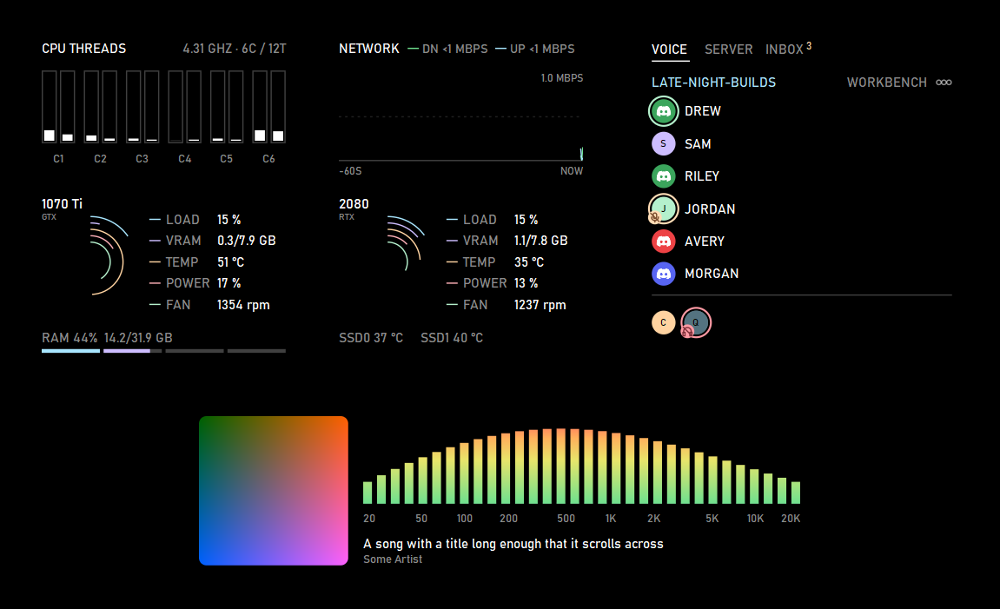

# Wallflex

[](https://github.com/BonelessPig/Wallflex/actions/workflows/ci.yml)
[](https://github.com/BonelessPig/Wallflex/releases/latest)
[](#license)
[](docs/SETUP.md)

Lightweight desktop widgets for Windows, drawn behind the desktop icons.
No Wallpaper Engine, no browser engine, no admin rights. It keeps itself
under 2% CPU and 120 MB of memory (typically 20 to 40 MB).



**[Download the latest release](https://github.com/BonelessPig/Wallflex/releases/latest)**
and see [docs/SETUP.md](docs/SETUP.md) to get started.

Wallflex paints a solid background on every monitor, between the
wallpaper and the icons, with widgets placed by a layout per monitor:

- **CPU threads:** a column per thread, grouped by real core, with the
  clock.
- **Network:** the last minute of download and upload, shaded green to
  red as it nears your connection's speed.
- **GPU rings:** per GPU, load, VRAM, temperature, power and fan.
- **RAM and SSDs:** RAM use with a bar per memory stick, SSD
  temperatures.
- **Discord** (optional): your call (who's talking, muted, deafened, on
  camera, sharing), recent notifications (click one to open it), a
  server's voice channels, and which friends are online.
- **Music visualizer** (optional): 32 bands from 20 Hz to 20 kHz for
  whatever your speakers play, with the song's art, title and artist.

Everything glides smoothly while your PC has room and eases off when
it's busy (or set `performance = "light"`). Sizes follow the monitor's
height, so the widgets look the same at any resolution.

## Tray icon

Wallflex puts an icon in the notification area (Windows 11 hides it
under **^** at first). Its menu opens the settings or the log, turns
**Start with Windows** on or off (a value under the current user's
`Run` key, no admin), and quits.

## Discord

Discord needs your own application from
<https://discord.com/developers/applications>: copy its client id and
secret from the OAuth2 page and add the redirect `http://localhost`
there, then fill in `[discord]` in the config and add a widget with
`kind = "discord"`. The first time, Discord asks you to approve
Wallflex.

For who's online and the FRIENDS page, also set `bot_token` (the
application's bot, with the Presence and Server Members intents turned
on, added to your servers) and `friends` (user ids: Discord settings >
Advanced > Developer Mode, then right-click a name > Copy User ID).

Discord only allows its local connection for an application's owner and
up to 50 testers, so each friend makes their own application.

## Settings

On first run Wallflex writes `%APPDATA%\Wallflex\config.toml`, with
comments explaining every option. Changes apply about a second after you
save. It sets:

- the background colour;
- a layout per monitor (all monitors, the primary one, a resolution such
  as `3440x1440`, or a name such as `DISPLAY2`);
- each widget's corner or edge and its distance from it, measured from
  the area the taskbar leaves free, plus an overall size per layout.

`performance = "smooth"` (the default) animates at up to 60 frames a
second while the PC has room and eases off when it's busy;
`performance = "light"` turns the glides off and reads sensors once a
second. Either way Wallflex holds itself under 2% CPU and 120 MB.

If the file has a mistake, Wallflex keeps the previous settings and
explains the problem in `%APPDATA%\Wallflex\wallflex.log`.

## Build

Needs Rust (stable, 1.88 or later) with the MSVC toolchain.

```
cargo build --release
```

The exe is `target\release\wallflex.exe`.

## Run

```
wallflex                      black background and sensor panel
wallflex --color 203040       background colour, overriding the config
wallflex --config my.toml     use another settings file
wallflex --sensors            print one sensor reading and exit
wallflex --preview 2160 a.bmp save the widgets as they'd look on a 2160p monitor
wallflex --preview 1440 a.bmp --widget discord   ... the Discord widget, sample data
wallflex --quit               stop the running copy
wallflex --diagnose           show how Explorer's desktop windows are laid out
```

Release builds have no console window; stop them from the tray menu
or with `--quit`. Debug
builds (`cargo run`) keep a console, and Ctrl+C stops them.

## Measuring

`tools\measure.ps1` runs the release build and reports RAM, CPU, threads
and whether a GPU driver was loaded:

```
powershell -ExecutionPolicy Bypass -File tools\measure.ps1 -Seconds 30
```

## Packaging

`tools\package.ps1` runs the checks, builds the release and writes
`dist\wallflex-<version>.zip` with the exe, the setup guide, the
default settings and the licences, and the installer
`dist\wallflex-<version>-setup.exe` from `installer\wallflex.iss`. The
installer needs [Inno Setup 6](https://jrsoftware.org/isinfo.php)
(`winget install JRSoftware.InnoSetup`); `-NoInstaller` makes only the
zip:

```
powershell -ExecutionPolicy Bypass -File tools\package.ps1
```

## Releases

Versions follow [Semantic Versioning](https://semver.org/), tagged
`vX.Y.Z`; before 1.0 the minor number goes up for new features or
changed settings and the patch number for fixes. Changes are listed in
[CHANGELOG.md](CHANGELOG.md). To release: set the version in
`Cargo.toml`, move the changelog's Unreleased notes under it, commit and
push, then run `tools\release.ps1` (it packages, tags and publishes the
GitHub release with the installer and the zip).

## License

Licensed under either of

- Apache License, Version 2.0 ([LICENSE-APACHE](LICENSE-APACHE))
- MIT license ([LICENSE-MIT](LICENSE-MIT))

at your option.

Unless you explicitly state otherwise, any contribution intentionally
submitted for inclusion in the work by you, as defined in the Apache-2.0
license, shall be dual licensed as above, without any additional terms or
conditions.
